# <Name>

<One or two sentences: what the system does and for whom.>

<!--
Copy this file to README.md and replace each <placeholder>.
Leave out the optional sections that do not apply.
Do not change the names or the sequence of the sections.
Rules: https://github.com/lucid-binary-GmbH/.github/blob/main/docs/writing-rules.md
-->

## Status

<What works. What does not work yet. Are the results validated?>

## How it works

```mermaid
flowchart TD
    Input["<Input>"] -->|"<What moves>"| Component["<Component>"]
    Component -->|"<What moves>"| Output["<Output>"]
```

<One sentence that tells the reader what the diagram shows.>



<Explain each component and each arrow of the diagram in text.>

## Install

Prerequisites:

- <Tool> <version> or later

```bash
<command>
```

## Run

```bash
<command> --<option>=<value>
```

- `<value>`: <meaning of the placeholder>

<The result that the reader gets, for example the files that the command writes.>

## Configuration

<Optional.>

| Name | Meaning | Default | Example |
|---|---|---|---|
| `<NAME>` | <meaning> | `<default>` | `<example>` |

## Inputs and outputs

<Optional. Format, location, units and a short example of the data that goes in and comes out.>

## Test

```bash
<test command>
```

<The expected result.>

## Related systems

- System definition: [<System name>](https://github.com/lucid-binary-GmbH/lucid-systems/blob/main/systems/<name>/SYSTEM.md)
- <Neighbour repository>: <what it sends to or receives from this repository>

## Known limitations

<Optional. What the system does not do yet. Link to an issue for planned work.>

## References

<Optional. Papers, datasets and external documentation, with a DOI or a URL.>
